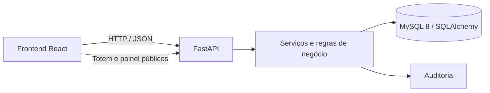
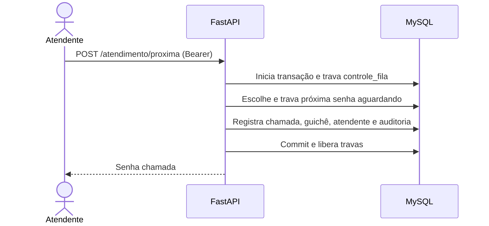

# nassauTickets

Sistema de Controle de Atendimento para Laboratório de Análises Clínicas. O cliente emite uma senha no totem; atendentes autenticados chamam e registram os atendimentos; gestores administram usuários e consultam relatórios.

## Tecnologias e versões

- **Backend:** Python 3.14 (imagem `python:3.14-slim`), FastAPI 0.136.3, SQLAlchemy 2.0.50, Pydantic 2.13.4 e Uvicorn 0.48.0. Dependências completas e versões: [`backend/requirements.txt`](backend/requirements.txt).
- **Banco:** MySQL 8.0, com driver PyMySQL 1.2.0.
- **Frontend:** React 19.3.0, Vite 8.3.2, `@vitejs/plugin-react` 6.1.1 e lucide-react 1.51.0, conforme `frontend/package-lock.json`.
- **Node.js:** 20.19 ou superior na linha 20, ou 22.12 ou superior. npm acompanha a instalação do Node.js.
- **Execução local recomendada:** Docker Engine e Docker Compose v2, Node.js e npm.

O backend em Python/FastAPI e o frontend React está integrado à API.

## Pré-requisitos e configuração

1. Instale Docker com Compose v2 e Node.js compatível com o Vite.
2. Na raiz do repositório, crie o arquivo local de configuração a partir do modelo:

   ```bash
   cp backend/.env.example backend/.env
   ```

   No PowerShell, use `Copy-Item backend/.env.example backend/.env`.
3. `backend/.env` contém valores de demonstração para uso local. Troque `JWT_SECRET_KEY` e as senhas antes de disponibilizar o sistema em uma rede compartilhada. Não versione o arquivo `.env` nem credenciais reais.

## Instalação e execução

### Banco de dados e API

Execute na raiz do repositório:

```bash
docker compose --env-file backend/.env -f backend/docker-compose-dev.yml up --build
```

O Compose inicia o MySQL 8.0 e aguarda o healthcheck do banco antes de iniciar a API. A API cria as tabelas com `Base.metadata.create_all()` na inicialização e popula os dados iniciais; **o projeto não usa Alembic nem possui migrations versionadas**. O volume `mysql_data` preserva o banco entre reinicializações.

- API: <http://localhost:8000>
- Swagger / OpenAPI interativo: <http://localhost:8000/docs>
- Especificação OpenAPI: <http://localhost:8000/openapi.json>
- Health check da API: <http://localhost:8000/health>
- MySQL no host: porta `3308` (dentro da rede Docker, porta `3306`).

Para encerrar os serviços, use `Ctrl+C`; para removê-los mantendo o banco, execute `docker compose --env-file backend/.env -f backend/docker-compose-dev.yml down`. Para apagar também os dados persistidos do banco, use `down -v`.

### Frontend

Em outro terminal, na raiz:

```bash
cd frontend
npm ci
npm run dev
```

Abra o endereço mostrado pelo Vite, normalmente <http://localhost:5173>. O frontend usa `http://localhost:8000` por padrão. Para apontar para outra API, copie `frontend/.env.example` para `frontend/.env` e ajuste `VITE_API_URL`. Para gerar a versão de produção, execute `npm run build`; os arquivos ficam em `frontend/dist/`.

## Usuários de teste e dados iniciais

Na configuração fornecida em `backend/.env.example`, a inicialização cria:

| Perfil | Login | Senha | Guichê |
|---|---|---|---|
| Gestor | `admin` | `admin123` | Sem vínculo fixo |
| Atendente | `atendente` | `atendente123` | Guichê 1 |

Essas credenciais são exclusivamente para demonstração local. O atendente é configurado com o perfil `ATENDENTE` por `SEED_ATENDENTE_PERFIL`; a conta `admin` recebe o perfil `GESTOR`. Os usuários e as senhas são configuráveis pelas variáveis `SEED_*` no `.env`.

Na primeira inicialização também são criados cinco guichês e o registro de controle da fila. O seed não recria usuários que já existem, exceto por atualizar o perfil e o vínculo de guichê do login de atendente configurado. Se o volume já tiver sido inicializado com outros valores, ajuste os usuários pelo sistema ou recrie o banco local conscientemente.

## API

A documentação interativa completa é publicada pelo próprio FastAPI em [`/docs`](http://localhost:8000/docs). Principais operações:

| Recurso | Operações |
|---|---|
| Autenticação | `POST /auth/login`, `GET /auth/me` |
| Senhas | `POST /senhas/emissir`, `GET /senhas/fila`, `GET /senhas/{codigo}` |
| Atendimento (Bearer) | `POST /atendimento/proxima`, `POST /atendimento/{id}/chamar-novamente`, `POST /atendimento/{id}/iniciar`, `POST /atendimento/{id}/finalizar`, `POST /atendimento/{id}/nao-compareceu` |
| Painel público | `GET /painel` |
| Guichês | `GET /guiches/get`; criação, edição e remoção exigem perfil gestor |
| Usuários (gestor) | `GET /usuarios/get`, `POST /usuarios/create`, `PUT /usuarios/update/{id}`, `DELETE /usuarios/delete/{id}` |
| Relatórios (gestor) | `GET /relatorios/diario`, `/mensal`, `/auditoria` e `/desempenho` |
| Expediente | `GET /expediente/status`; `POST /expediente/encerrar` exige gestor |

O caminho `/senhas/emissir` está escrito assim no código e é o endpoint usado pelo frontend.

## Fila, estados e concorrência

Estados persistidos: `EMITIDA`, `AGUARDANDO`, `CHAMADA`, `CHAMADA_NOVAMENTE`, `EM_ATENDIMENTO`, `ATENDIDA` e `NAO_COMPARECEU`. A fila alterna chamadas prioritárias (`SP`) com `SE`/`SG`; quando ambas as filas comuns têm senhas, `SE` é escolhida primeiro. Não há restrição de tipo de senha por guichê; um atendente vinculado a um guichê só pode operar naquele guichê. Os registros de chamada guardam guichê e atendente.

O serviço de atendimento trava a linha única `controle_fila` com `SELECT ... FOR UPDATE` antes de selecionar a próxima senha. Isso serializa chamadas concorrentes no MySQL/InnoDB. A busca também usa `FOR UPDATE SKIP LOCKED` na senha aguardando. O bloco transacional atualiza estado, atendente, guichê e auditoria antes do commit, evitando que duas chamadas simultâneas selecionem a mesma senha.





## Testes e verificações

O repositório **ainda não inclui uma suíte automatizada** nem dependências de teste. Para conferir manualmente a instalação, abra `/docs`, autentique com as contas acima, emita uma senha, percorra as operações de atendimento e consulte painel e relatórios conforme o perfil. O frontend pode ser validado com `cd frontend && npm ci && npm run build`. 

## Funcionalidades

### Implementadas

- Emissão anônima de senhas SP, SG e SE e consulta da fila.
- Autenticação JWT e autorização por perfil para atendimento, gestão de usuários, guichês e relatórios.
- Chamada, segunda chamada, início e finalização de atendimento, registro de não comparecimento e auditoria dos eventos.
- Painel com as cinco chamadas mais recentes e anúncio de voz opcional no navegador.
- Relatórios diários, mensais, de auditoria e de desempenho.
- Horário de expediente configurável; consulta de status e encerramento manual do expediente pelo gestor.
- Inicialização de tabelas e dados básicos, Compose para API e MySQL e interface web integrada.

### Não implementadas ou com limitação conhecida

- Migrations versionadas (Alembic), suíte automatizada, pipeline CI e testes de concorrência.
- Encerramento automático do expediente por agendador; o endpoint de encerramento é acionado manualmente pelo gestor.
- Política operacional de backup e recuperação de desastre documentada/automatizada.
- Endurecimento para produção, como gestão de segredos, TLS e revisão de política de CORS.
- O mecanismo de schema usa `create_all`; alterações em modelos existentes não migram automaticamente bancos já criados.

## Privacidade e segurança

Senhas de usuários são armazenadas como hash bcrypt e as rotas restritas usam token Bearer. Totem, fila e painel são públicos por projeto. Não inclua dados reais de pacientes nos dados de demonstração, commits, screenshots ou documentação. Use apenas dados fictícios na apresentação e configure segredo JWT, senhas e CORS de acordo com o ambiente antes de expor a aplicação.

## Requisitos do sistema

Consulte [`docs/requirements/requisitos.md`](docs/requirements/requisitos.md) e o documento [`Sistema para controle de atendimento.pdf`](docs/requirements/Sistema%20para%20controle%20de%20atendimento.pdf).

| Nome | Matrícula | Papel |
|---|---|---|
| Pedro Santos | 01795967 | Scrum Master |
| Brunno Santos | 01796945 | Documentador |
| Sérgio Júnior | 01800630  | Desenvolvedor |
| João Batista  |  01791156 | Desenvolvedor |
| Rhuan de melo | 01821902 | Testador |

## Uso de IA

Foi utilizado sim IA, foi utilizado Codex no front end e Opencode back end, sendo o front feito com uso da IA apenas como auxilio usando como base um sistema real de senhas da empresa onde o desenvolvedor do front end trabalha, o mesmo se aplica ao backend, foi usado como base o codigo do backend de um sistema real de uma empresa

## Licença

Este projeto está sob a licença MIT. Consulte [`LICENSE`](LICENSE).
